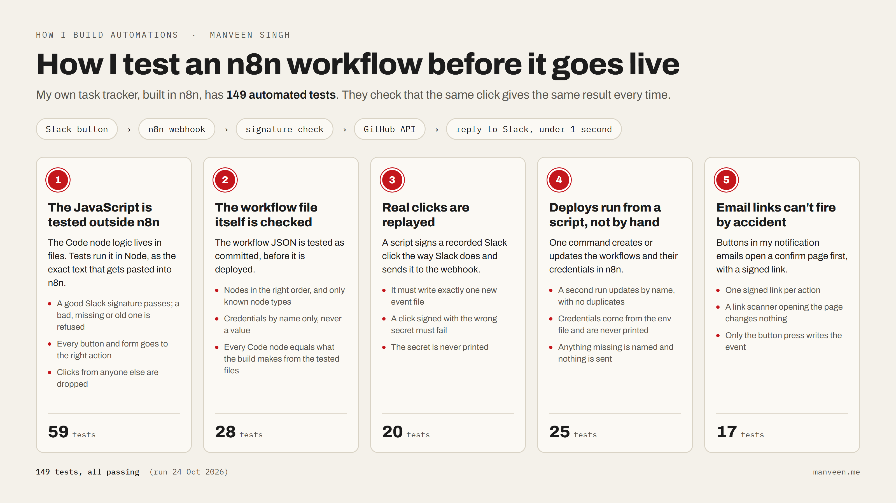

### Hi, I'm Manveen

I build automations that run on their own for small businesses and teams: n8n workflows, Python pipelines and AI agents. I test them like software, so "Success" means the work actually happened. Based in New Delhi, working remotely.

Open to freelance automation work and remote AI engineering roles. [manveen.me](https://manveen.me) · [manveen9650@gmail.com](mailto:manveen9650@gmail.com) · [LinkedIn](https://www.linkedin.com/in/manveen-singh-b9b7672a0)

**What I've built**

- **[Tender Radar](https://github.com/Manveen07/tender-radar-showcase)** reads every new UK public tender each morning and answers bid, maybe or skip, with the reason quoted from the notice. 3,671 checks so far, running unattended on GitHub Actions since July.
- **A Slack task tracker on n8n with 149 tests.** The Code-node JavaScript, the workflow file, replayed Slack clicks, deploys and email links are all tested. [How I test it](https://manveen.me/writing/149-tests-for-a-few-slack-buttons), and [a public version you can run](https://github.com/Manveen07/n8n-workflow-tests) with 45 tests.
- **An engineering-drawing reader** that turns PDFs into a quote sheet. On 23 hand-checked drawings it got 7 values wrong out of 419, and parts lists 194 of 194. Every value carries the text it came from. [How I marked it](https://manveen.me/writing/marking-the-ais-homework).
- **An AI receptionist** that answers phone calls and books appointments. A second AI plays difficult callers, and plain-code checks fail any call that invents a price or books outside opening hours.
- **A daily lead feed.** Claude judges posts from Slack communities, LinkedIn, Reddit and forums. On 58 hand-labelled posts it catches 14 of 14 real leads with 0 false alarms.
- **At work** (GTM automation engineer at Precise Leads): the outbound pipeline that sorted 34,044 companies in four days, with 0 contradicted claims in 300 drafted emails.

Most of my work is in private repos, so these link to write-ups and showcase code instead.

**Writing**

- [149 tests for a few Slack buttons](https://manveen.me/writing/149-tests-for-a-few-slack-buttons)
- [Marking the AI's homework](https://manveen.me/writing/marking-the-ais-homework)
- [How I caught my own AI test cheating](https://manveen.me/writing/schema-as-eval-spec)
- [Things AI got confidently wrong](https://manveen.me/writing/things-ai-got-confidently-wrong)

**Tools I use most:** Python, TypeScript, n8n, Claude and Gemini APIs, Playwright, GitHub Actions, Next.js, Clay.

